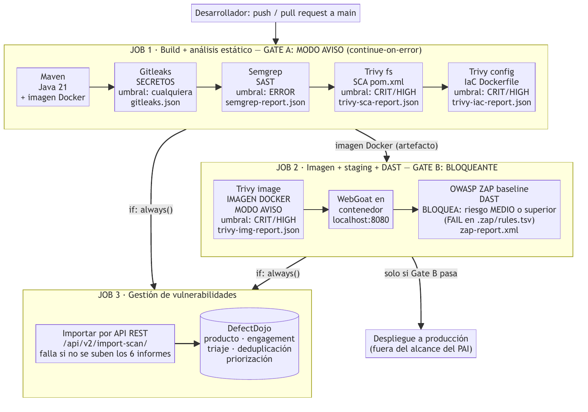
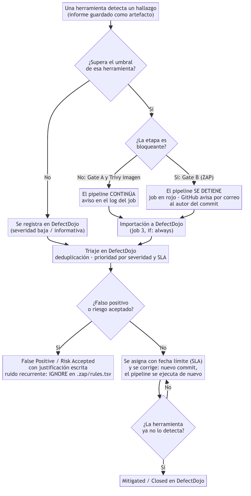

# Diagramas del pipeline DevSecOps (PAI-4)

Corresponden a `.github/workflows/devsecops-webgoat-improved.yml`. Las fuentes Mermaid están en
`pipeline.mmd` y `flujo.mmd` (GitHub las muestra renderizadas).

## 1.a Diagrama del pipeline

| Etapa | Herramienta | Tipo | Informe | Gate | Umbral |
|---|---|---|---|---|---|
| Job 1 | Gitleaks | Secretos | gitleaks.json | A · aviso | cualquier secreto |
| Job 1 | Semgrep | SAST | semgrep-report.json | A · aviso | severidad ERROR |
| Job 1 | Trivy fs (pom.xml) | SCA | trivy-sca-report.json | A · aviso | CRITICAL / HIGH |
| Job 1 | Trivy config | IaC | trivy-iac-report.json | A · aviso | CRITICAL / HIGH |
| Job 2 | Trivy image | Imagen | trivy-img-report.json | aviso | CRITICAL / HIGH |
| Job 2 | OWASP ZAP | DAST | zap-report.xml | **B · bloqueante** | riesgo medio o superior |
| Job 3 | DefectDojo | Gestión | — | falla si faltan informes | 6 informes |

## 1.b Diagrama de flujo ante una vulnerabilidad

